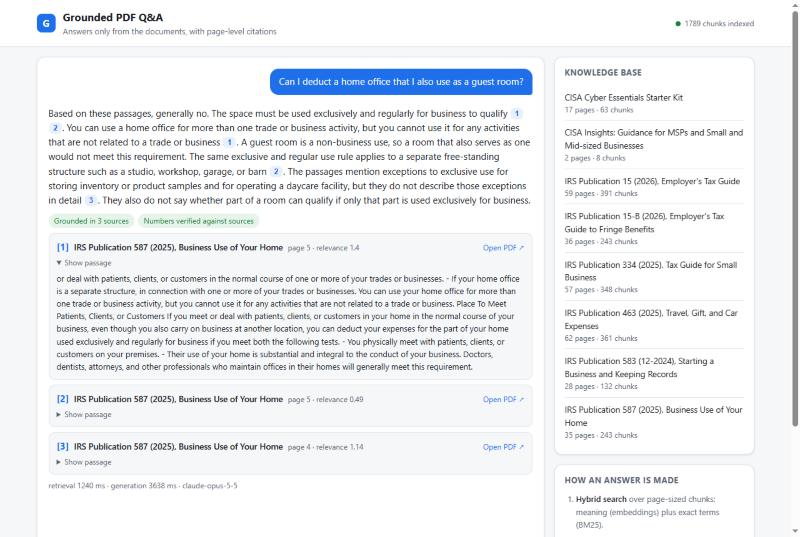
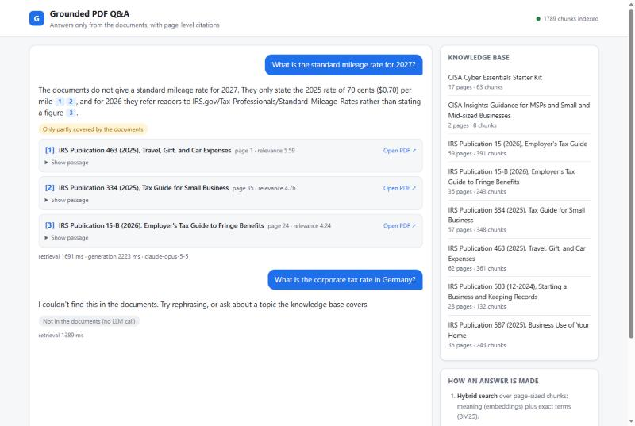
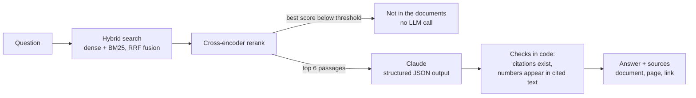

# Grounded PDF Q&A

A retrieval-augmented chatbot that answers **only** from its PDF documents, cites the **document and page** behind every statement, and says *"not in the documents"* instead of guessing.

The demo knowledge base is a small-business help desk: six IRS small-business tax guides and two CISA cybersecurity guides (296 pages, public-domain US government works). Swap in your own PDFs and re-run one command.



## Results

Measured on a hand-written set of 20 answerable questions (each checked against the PDF text) and 6 questions the documents do not answer. Full per-question output: [eval/report.md](eval/report.md).

| Metric | Result |
|---|---|
| Correct source in the top 6 passages | **20/20** |
| Facts in the answer correct | **19/20** |
| Unanswerable questions declined | **6/6**, 4 of them before any LLM call |
| Answers whose every number appears in a cited passage | **19/19** |
| Median latency | 4.9 s |
| LLM cost for all 26 questions | $0.37 |

When the model does produce a figure that is not in its sources, for example a maximum it calculated itself (300 sq ft × $5 = $1,500), the answer is shown with a "check this" flag rather than passed off as sourced. This happened in an earlier run and is covered by a unit test.

One of the six trap questions asks for the 2027 mileage rate. The documents only contain the 2025 rate, so retrieval scores it as highly relevant, and the model still declines because the 2027 figure isn't there. It says what the documents do contain and labels the answer "only partly covered". An off-topic question is declined by the relevance threshold before any LLM call:



## How an answer is made



1. **Ingestion** ([app/pdf_parse.py](app/pdf_parse.py)). PyMuPDF extracts text page by page. Running headers and footers ("Publication 15 (2026)", page numbers) are detected as short lines repeated across a document's pages and removed. Pages are split into ~180-word chunks along sentence boundaries with a 40-word overlap. **Chunks never cross a page**, so every citation points to exactly one page.
2. **Hybrid retrieval** ([app/store.py](app/store.py)). Each chunk is indexed in Qdrant twice: a dense embedding (`bge-small-en-v1.5`) for meaning, and BM25 for exact terms such as "Form 941" or "section 179". The two candidate lists are fused with Reciprocal Rank Fusion. Chunks are embedded with their document title as a header, so questions that name a document find its pages.
3. **Reranking.** A cross-encoder rescores the top 30 candidates against the question. Its score also decides whether anything is relevant at all: below the threshold, the bot declines without calling the LLM, which is both safer and free.
4. **Generation** ([app/llm.py](app/llm.py)). Claude receives only the top passages, numbered, and returns JSON (`found`, `answer`, `citations`) through structured outputs. The prompt forbids outside knowledge, requires a citation per factual sentence, and asks for amounts and dates to be copied exactly.
5. **Verification** ([app/validate.py](app/validate.py)). Nothing the model says is trusted blindly:
   - citations must refer to passages that were actually retrieved, and unknown ones are removed;
   - an answer marked as found but without a valid citation is downgraded to "not found";
   - every number in the answer must appear in the text of a cited passage, otherwise it is shown as "check this";
   - a partial answer keeps its sources and is labelled "only partly covered".

All embedding and reranking models run locally on CPU (ONNX via fastembed), so indexing and search need no API key. Only the final answer step calls the Claude API.

## Run it

Requirements: Python 3.11+ and an Anthropic API key.

```bash
python -m venv .venv
.venv/Scripts/pip install -r requirements.txt      # macOS/Linux: .venv/bin/pip
cp .env.example .env                                # then add ANTHROPIC_API_KEY
python -m app.ingest                                # parse + index the PDFs in data/pdfs (~4 min on CPU)
uvicorn app.api:app --port 8000                     # open http://localhost:8000
```

With Docker (API + Qdrant server):

```bash
docker compose up -d --build
docker compose run --rm api python -m app.ingest
```

To use your own documents, put PDFs in `data/pdfs/`, optionally add titles in `data/documents.json`, and run `python -m app.ingest` again.

## API

| Method | Path | Description |
|---|---|---|
| `POST` | `/api/chat` | `{"question": "..."}` returns the answer, `found`, the sources (document, page, passage, relevance score), the verification results, timings and token usage |
| `GET` | `/api/documents` | Documents in the index with page and chunk counts |
| `GET` | `/api/health` | Index status |
| `GET` | `/pdfs/{file}#page=N` | The source PDF, opened at the cited page |

Questions are limited to 500 characters and 20 per IP address per 10 minutes.

## Evaluation and tests

```bash
python -m eval.run_eval --retrieval-only   # retrieval metrics, no API calls, free
python -m eval.run_eval                    # full run with Claude, writes eval/report.md
python -m pytest                           # 22 unit and API tests, no network or API key needed
```

The question set is in [eval/questions.jsonl](eval/questions.jsonl). Each answerable question lists the expected document, the pages that contain the answer and the facts the answer must include. Every expectation was checked against the extracted PDF text.

## Configuration

All settings are environment variables, see [.env.example](.env.example): model (`CLAUDE_MODEL`, default `claude-opus-5-5`), effort, `TOP_K`, the relevance threshold `MIN_RERANK_SCORE`, and chunk size and overlap. The threshold was calibrated on the data: answerable questions score between +1 and +8, off-topic ones below −5.

## Known limitations and next steps

- **Layout-heavy pages.** One question failed: the CISA starter kit lists its focus areas on a poster-style, multi-column page, and plain text extraction scrambles it. The bot answered the part it found and labelled the rest as not covered instead of inventing it. Layout-aware parsing (block-level extraction, or a vision model for infographic pages) is the fix.
- **Scanned PDFs** have no text layer; an OCR step (Tesseract or a cloud OCR) would be added before chunking.
- **Conversation memory.** Each question is answered independently. Follow-ups such as "and for 2025?" would need query rewriting from the chat history.
- **Scale.** The embedded Qdrant store suits a single instance; the Docker setup already uses the Qdrant server, which scales to millions of chunks.

## Project layout

```
app/
  pdf_parse.py   PDF -> clean page text -> page-bounded chunks
  store.py       Qdrant index, hybrid search, reranking
  llm.py         Claude call with structured output
  validate.py    citation and number checks
  rag.py         the question -> answer pipeline
  api.py         FastAPI endpoints, rate limit, static UI
  static/        single-page chat UI (no build step)
eval/            question set, evaluation runner, latest report
tests/           unit and API tests
data/pdfs/       the source documents
```

## Documents and licence

The PDFs are publications of the US Internal Revenue Service and the Cybersecurity and Infrastructure Security Agency. As works of the US federal government they are in the public domain. Sources are listed in [data/documents.json](data/documents.json). They are used here as sample data only. This demo does not give tax advice.

Code: MIT licence.
